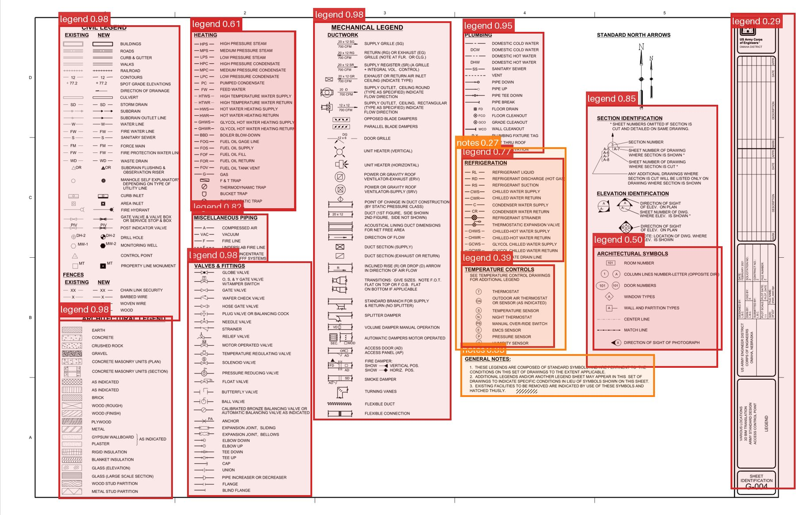
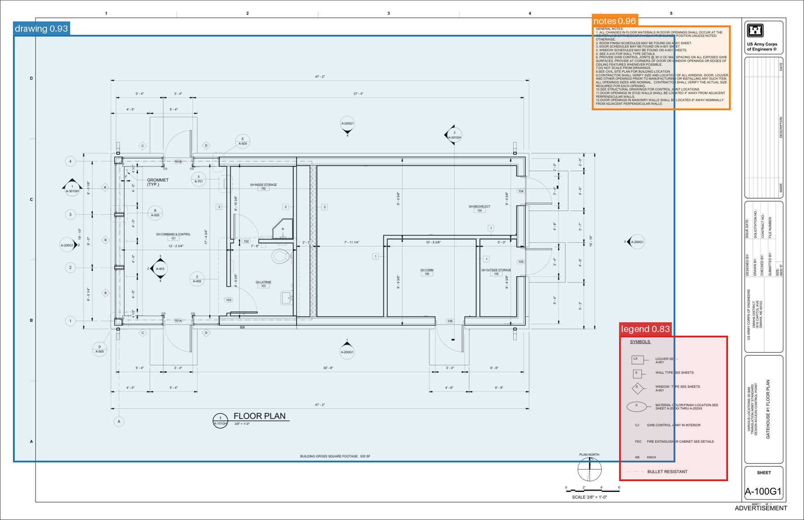
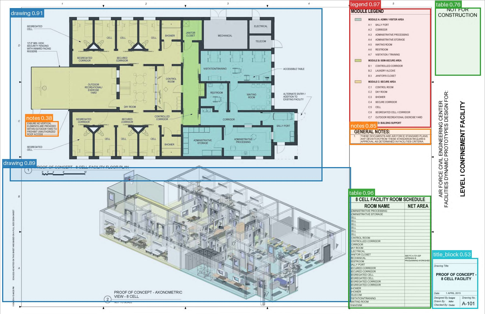
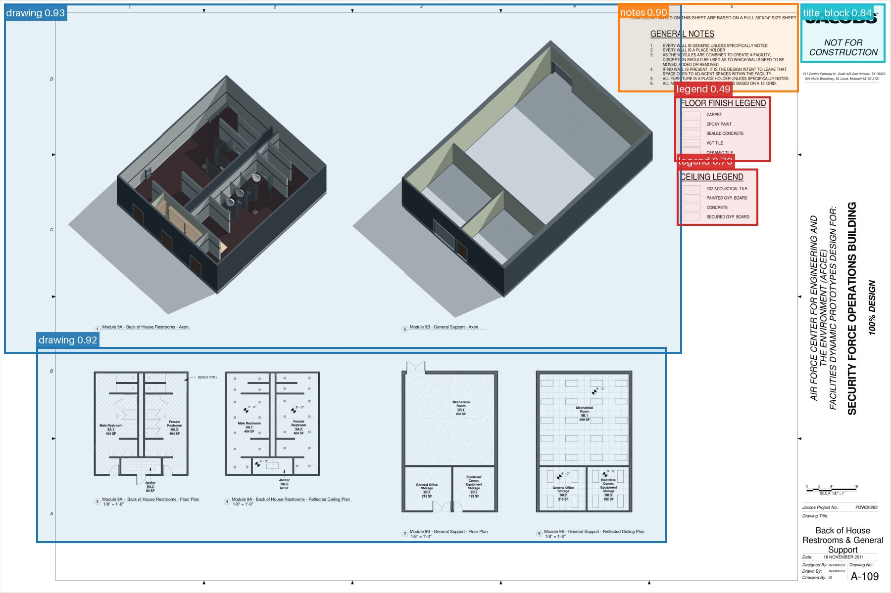
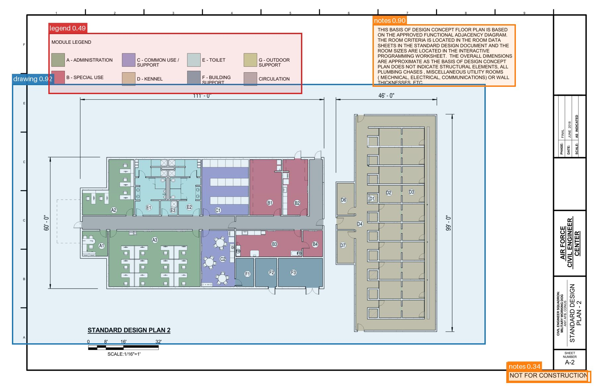
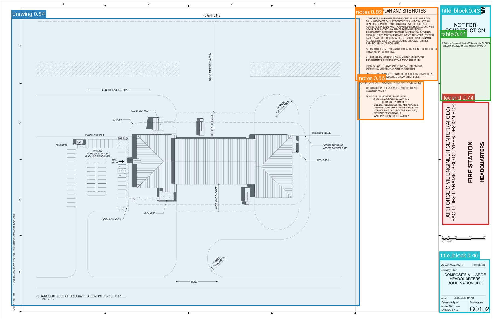
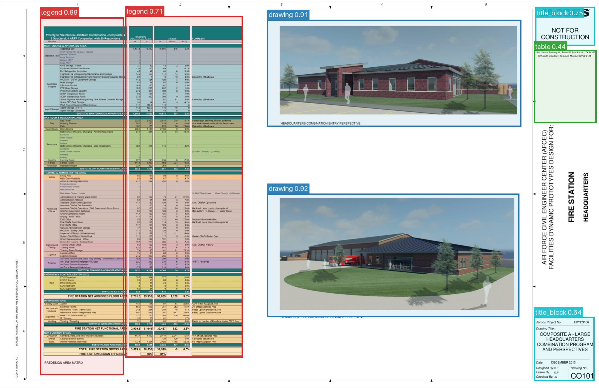

# Drawing sheet regions

Find the parts of a construction drawing sheet: the **drawing** itself, **legends**, **tables**,
**notes**, **abbreviation lists** and the **title block**. It is a fine-tuned
[DocLayout-YOLO](https://github.com/opendatalab/DocLayout-YOLO) model, built from 1,066 hand-labelled
sheets: 870 for training, 60 for validation and 136 for testing.

Use it as the first step of reading a drawing. It tells the next step where to look: crop the legend
before searching for its symbols, or read the title block for the sheet number.


<sub>A symbols sheet from a US Army Corps of Engineers standard design (ACP-STDG-004, public). Every
box is drawn by this model. Each legend block is found. One mistake: the tall title strip on the right
is marked `legend` (0.29).</sub>

## What it finds

| Colour | Region | What counts |
|---|---|---|
| 🟦 | `drawing` | The plan, section, elevation or detail. One box per drawn view; symbols on the plan are not boxed one by one. |
| 🟥 | `legend` | A symbol key: a shape you could draw with a pen, next to what it means. |
| 🟩 | `table` | Any ruled grid: schedules, revision lists, drawing indexes, design-criteria tables. |
| 🟧 | `notes` | General notes and other blocks of text. |
| 🟪 | `abbreviation` | A letters-only key, such as "FFL - finished floor level". |
| 🩵 | `title_block` | The block with the project, sheet number, revision, date and firm. |

The boxes mark regions, not tight outlines. The weights hold a seventh class, `unknown`, which was
used for one small mark that recurs at the edge of many training sheets. `predict.py` drops it.

## Quick start

```bash
git clone https://github.com/pipo-x/drawing-sheet-regions
cd drawing-sheet-regions
python -m venv .venv && source .venv/bin/activate
pip install -r requirements.txt

python predict.py examples/ACP-STDG-004.pdf --draw out/
```

Each page prints one JSON line (shortened here):

```json
{"file": "ACP-STDG-004.pdf", "page": 1, "width": 2400, "height": 1553,
 "boxes": [{"label": "legend", "conf": 0.983, "box_px": [176, 77, 543, 968], "box": [0.0733, 0.0494, 0.2262, 0.6235]}, ...]}
```

- `box_px` is in pixels of the rendered page.
- `box` gives the same box as fractions of the page width and height, so it can be drawn on a render
  of any size.
- `--draw` also writes a picture of each page with its boxes.
- `--pages 2 5` reads only those PDF pages.
- `--conf` sets the lowest confidence kept (default 0.25).
- PNG and JPEG files work as well as PDFs.

From Python:

```python
from pathlib import Path
from predict import load_model, pages_of, detect

model = load_model()
for page, image in pages_of(Path("sheet.pdf"), None):
    for box in detect(model, image):
        print(page, box["label"], box["conf"], box["box"])
```

Pages are rendered so their longest side is 2,400 pixels, as in training, and the model runs at
768 px. The one-page example takes about 4 seconds on an Apple M4 laptop, most of it loading the
model.

## Examples

All on public drawings the model never saw, with its mistakes left in.


<sub>**CAD floor plan** (USACE gatehouse, sheet A-100G1). It finds the plan, the general notes and the
symbols legend. It misses the title strip on the right.</sub>

| | |
|---|---|
|  |  |
| **Plan, axonometric and schedule.** It finds both drawings, the module legend, the general notes, the room schedule and the title block. It marks the "not for construction" box as a table. | **Axonometrics and plans.** It finds both rows of drawings, the general notes, the floor finish and ceiling legends and the top of the title block. |
|  |  |
| **Kennel floor plan.** It finds the drawing, its colour legend and the design notes. It misses the title strip on the right, and boxes the "not for construction" stamp as notes. | **Fire-station site plan.** It finds the drawing, both note blocks and the title block (bottom right). It marks the vertical project-name strip as `legend` (0.74). |

## How well it works

The test sheets come from **3 projects with no sheets in training**: 136 sheets in two sets.

| | Test A | Test B |
|---|---:|---:|
| Projects | 2 | 1 |
| Sheets | 99 | 37 |
| Boxes (6 classes) | 584 | 256 |
| **mAP50** | **0.72** | **0.69** |
| mAP50-95 | 0.59 | 0.49 |

By region, on test A:

| Region | AP50 | Precision | Recall | Boxes | AP50 on test B |
|---|---:|---:|---:|---:|---:|
| drawing | 0.90 | 0.91 | 0.88 | 126 | 0.89 |
| table | 0.88 | 0.91 | 0.74 | 206 | 0.93 |
| notes | 0.78 | 0.87 | 0.74 | 92 | 0.61 |
| title_block | 0.78 | 0.80 | 0.73 | 115 | 0.77 |
| legend | 0.54 | 0.78 | 0.54 | 28 | 0.65 |
| abbreviation | 0.46 | 1.00 | 0.00 | 17 | 0.32 |

Precision and recall are taken at the confidence that maximises F1 over all classes. "Boxes" counts
the human boxes of that class in the test set.

**What this means:**
- The drawing, tables and title block are found most of the time on new projects.
- About half of the legends are found. When the model does mark a legend, it is usually right.
- Abbreviation lists are rarely found: there are few of them in training (308 boxes).

## What it gets wrong


<sub>**Table read as a legend.** A coloured area schedule is marked `legend`. The two renders and the
title block are found.</sub>

- **US-style title strips.** We ran it on 1,695 pages from 186 public US federal drawing sets, without
  answer keys. A title block was boxed on 620 of them (37%). A tall strip down the right edge, common
  on US sheets, is often missed, or marked `legend`.
- **A legend inside the drawing area** is often covered by the `drawing` box instead of getting its
  own.
- **Diagrams drawn as grids**, such as control-panel layouts, can be taken for tables or legends.
- **The boxes are loose**, which is why mAP50-95 sits well below mAP50. That is fine for cropping a
  region, not for anything that needs exact edges.
- **It only finds regions.** It does not read the text or the symbols inside them.

## How it was trained

- **Start:** DocLayout-YOLO's DocStructBench weights
  ([`juliozhao/DocLayout-YOLO-DocStructBench`](https://huggingface.co/juliozhao/DocLayout-YOLO-DocStructBench)).
  Those are trained on documents such as papers, textbooks and reports. They have no legend or
  title-block class, and they miss a table that sits as a panel inside a drawing.
- **Data:** 870 sheets from 10 building projects, with 8,547 boxes drawn by hand by two people. A
  further 60 sheets from the same projects were used for validation. The training sheets are not part
  of this release.

  | Region | drawing | legend | table | notes | abbreviation | title_block | unknown |
  |---|---:|---:|---:|---:|---:|---:|---:|
  | Training boxes | 1,365 | 528 | 1,905 | 2,550 | 308 | 1,199 | 692 |

- **Settings:** 46 epochs, 768 px, batch 8, seed 0, about 7.5 hours on an Apple M4 laptop (MPS).
- **No left-right flips and no mosaic.** Both are on by default in YOLO training, and both are wrong
  for drawing sheets. Title blocks sit on one side and legends read symbol-then-text, so a mirrored
  sheet teaches a layout that does not exist. Mosaic stitches four sheets into one, which gives one
  "sheet" four title blocks.

**Versions.** Four training runs were scored on the same test sheets. This release is the last one.

| Training sheets | mAP50 test A | mAP50 test B | Legend AP50 test A / B |
|---|---:|---:|---:|
| 304 (earlier run) | 0.69 | 0.66 | 0.42 / 0.47 |
| 304 | 0.70 | 0.69 | 0.53 / 0.49 |
| 587 | 0.73 | 0.69 | 0.54 / 0.50 |
| **870 (this release)** | **0.72** | **0.69** | **0.54 / 0.65** |

More labelled sheets helped up to about 600 and then levelled off overall. The 870-sheet model is the
best at legends and on the validation sheets (mAP50 0.88).

## Files

| Path | What |
|---|---|
| `weights/sheet_regions.pt` | The model, 40 MB. It holds the network and its class names only, with no training state. |
| `predict.py` | Render, detect, print JSON, and optionally draw. |
| `examples/` | The pictures above, and one public PDF sheet to try. |

## Licence and credits

- **Code and weights:** [AGPL-3.0](LICENSE), the licence of the DocLayout-YOLO library this builds on.
  The starting weights are Apache-2.0.
- **Example drawings:** US federal standard designs, published openly. The sheets used carry no
  copyright or distribution notice.
  - U.S. Army Corps of Engineers, Omaha District, Access Control Point standard design, sheets
    ACP-STDG-004 and A-100G1
    ([USACE Centers of Standardization](https://mrsi.erdc.dren.mil/content/cos/)).
  - U.S. Air Force Civil Engineer Center, Confinement Facility standard design, sheet A-101
    ([WBDG](https://www.wbdg.org/FFC/AF/AFDP/CONFINEMENT/ConfinementFacility01APR15.pdf)).
  - U.S. Air Force Civil Engineer Center, Security Forces Operations Building prototype, sheet A-109
    ([WBDG](https://www.wbdg.org/FFC/AF/AFDP/SFO/SFO%20PDF%20Version%20of%20all%20Sheets%20v1.0.pdf)).
  - U.S. Air Force Civil Engineer Center, Fire Station - Headquarters prototype, sheets CO101 and CO102
    ([WBDG](https://www.wbdg.org/FFC/AF/AFDP/FIRE_STATION/fs_proto_hq.pdf)).
  - U.S. Air Force, Military Working Dog Kennel standard design, sheet A-2
    ([WBDG](https://www.wbdg.org/FFC/AF/AFDP/KENNEL/drawings_mil_work_dog_june_2018.pdf)).

Built on DocLayout-YOLO:

```bibtex
@misc{zhao2024doclayoutyolo,
  title  = {DocLayout-YOLO: Enhancing Document Layout Analysis through Diverse Synthetic Data and Global-to-Local Adaptive Perception},
  author = {Zhiyuan Zhao and Hengrui Kang and Bin Wang and Conghui He},
  year   = {2024},
  eprint = {2410.12628},
  archivePrefix = {arXiv}
}
```
